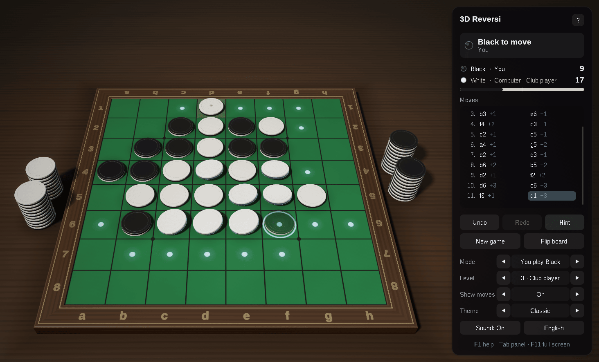
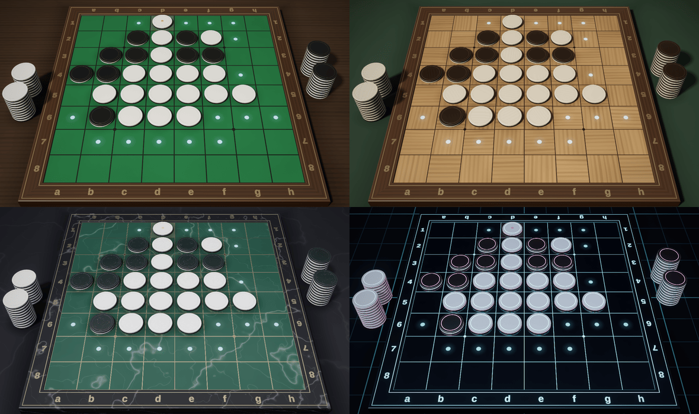

# 3D Reversi — C++23, Win32 and OpenGL 4.6

[](https://github.com/sponsors/makarov-mm)
[](LICENSE)


[](https://www.linkedin.com/in/makarov-mm/)
[](https://www.threads.net/@m.m.makarov)
[](https://www.instagram.com/m.m.makarov/)

A 3D Reversi (Othello) game for Windows written in modern C++ on plain Win32 and OpenGL 4.6.

There is no game engine, framework or third-party library, and no model, texture or sound file: the discs are turned on a lathe in code at startup, the materials are procedural, the lighting environment is baked on the GPU, and the sounds are synthesized. The shaders are built into the executable, so the game is a single `.exe`.





## Features

### Rules

- The standard rules: Black moves first from the four discs in the middle; a disc must bracket a line of the opponent's discs, which all turn over
- A side with no move passes, and the pass is announced; the game ends when neither side can move, and the most discs wins
- The squares are named as on a printed board, `a1` at the top left, so transcripts such as `f5d6c3d3c4` read the usual way

### Play

- A computer opponent with five levels, from Beginner to Master: iterative deepening, principal variation search and a transposition table, with an evaluation of mobility, frontier, corners, the squares next to them and stable discs, tuned in matches against itself; from 20 empty squares (at the top level) it plays the ending out exactly. It thinks in the background, so the window stays responsive
- Play Black, play White, two players on one computer, or watch a demo game
- The legal moves are marked; over one of them a see-through disc shows the move, and the discs it would turn lean towards turning and glow. The marks can be switched off
- Undo and redo, the move list with how many discs each move turned, the discs of each side and a bar of the score
- Hints: the suggested square is ringed
- Copy the game as a transcript or the position as a board string, and paste either to continue from it
- The game in progress and the settings are kept between sessions
- English and Russian interface, chosen from the system language
- Sound effects, full screen, per-monitor DPI awareness, a dark title bar
- No work while nothing moves: the game waits for input instead of drawing the same picture

### Graphics

- Physically based shading: GGX highlights, a clear lacquer coat, soft light inside the discs, image-based lighting from a procedural studio environment
- Soft shadows (PCSS), contact shadows, and the discs reflected in the polished boards
- HDR rendering with 4× MSAA, bloom, ACES tone mapping, vignette and dithering
- Smooth edges everywhere: multisampling for the outlines, and the grid lines, the dots and the marks drawn by the shaders filtered over each pixel; highlights widen where the surface curves within a pixel, so they do not sparkle
- Discs of two halves turned on a lathe, white on one face and black on the other, with a fine groove where they meet
- Animation: each disc flies from its player's stack beside the board to its square, then the discs it brackets turn over in a wave running out from it; a move taken back runs the other way, and a new game dissolves in
- Four themes: Classic (green baize), Walnut, Marble and Neon
- An interface of frosted-glass panels, sharp at any screen scale

## Controls

| Action | Control |
|---|---|
| Place a disc | Click a marked square |
| Turn the view | Drag with either mouse button |
| Zoom | Mouse wheel |
| Take back / replay a move | `Ctrl+Z` / `Ctrl+Y`, `←` / `→`, `Backspace` |
| Hint | `H` |
| New game | `N` |
| Flip the board | `F` |
| View from above | `V` |
| Reset the view | `Home` |
| Computer level | `1` … `5` |
| Who plays whom | `M` (`Shift+M` back) |
| Show / hide the legal moves | `D` |
| Next theme | `T` (`Shift+T` back) |
| Sound on / off | `S` |
| English / Russian | `L` |
| Show / hide the panel | `Tab` |
| Full screen | `F11`, `Alt+Enter` |
| Copy the game / the position | `Ctrl+C` / `Ctrl+Shift+C` |
| Paste a game or a position | `Ctrl+V` |
| Help | `F1` |
| Leave full screen | `Esc` |

## Requirements

- Windows 10 (version 1703 or later) or Windows 11, x64
- A graphics card and driver with OpenGL 4.6 (4.5 is enough)
- Visual Studio 2026 with the **Desktop development with C++** workload; the project uses the C++23 language standard (`/std:c++23`, or `/std:c++23preview` with MSVC Build Tools older than 14.52)

## Building and running

Open `Reversi3D.slnx` in Visual Studio, choose the **Release | x64** configuration and run the project (`Ctrl+F5`).

From a Developer PowerShell:

```powershell
msbuild Reversi3D.slnx -p:Configuration=Release -p:Platform=x64
.\bin\x64\Release\Reversi3D.exe
```

The Release build links the C++ runtime statically, so `Reversi3D.exe` runs on its own. The settings and the game in progress are kept in `%APPDATA%\Reversi3D\Reversi3D.ini`.

## Project structure

```text
.
├── assets/                Reversi3D.ico
├── shaders/               GLSL shaders, built into the executable as resources
├── src/
│   ├── Main.cpp           entry point
│   ├── App.*              the window, game flow, input and interface
│   ├── Reversi.*          the rules: bitboard move generation, notation, transcripts, the game record
│   ├── Engine.*           the computer player: search, evaluation and the exact solver of the ending
│   ├── PieceModels.*      the two halves of the disc, turned on a lathe
│   ├── BoardGeometry.*    meshes of the board, its frame and the table
│   ├── BoardView.*        the discs on the board and in the stacks, and their animation
│   ├── Camera.*           orbit camera and mouse rays
│   ├── Renderer.*         the rendering pipeline
│   ├── Themes.*           materials and lighting of the themes
│   ├── Gl.*               OpenGL context (WGL) and functions
│   ├── Text.*             font atlases rendered with GDI
│   ├── UiPainter.*        drawing of the interface
│   ├── Sound.*            synthesized sound effects
│   ├── Settings.*         the settings file
│   ├── Strings.*          English and Russian texts
│   ├── Resources.*        access to the resources built into the executable
│   ├── MathTypes.h        vectors and matrices
│   └── Win32.h            windows.h and UTF-8 conversions
├── Reversi3D.rc           the icon, version information and shaders
├── Reversi3D.vcxproj
└── Reversi3D.slnx
```

## How a frame is drawn

1. **Shadow map** — the discs seen from the key light, for soft shadows.
2. **Reflection** — the discs mirrored under the board, drawn at half resolution and blurred into mipmaps, so the polish of each theme can show a sharper or softer reflection.
3. **Main pass** — the table, the board and the discs in HDR with 4× MSAA, lit by the key light and the baked environment; the background is the environment itself, and the disc a click would place is blended over it all.
4. **Post-processing** — the samples are resolved, bright parts spread into a six-level bloom, and the composite pass applies tone mapping and vignetting and frosts the glass behind the interface panels.
5. **Interface** — panels, text and icons, drawn on top.

The environment maps are baked with compute shaders when the theme changes, and the BRDF table once at startup.

## License

MIT License

Copyright (c) 2026 Mykhailo Makarov

Permission is hereby granted, free of charge, to any person obtaining a copy
of this software and associated documentation files (the "Software"), to deal
in the Software without restriction, including without limitation the rights
to use, copy, modify, merge, publish, distribute, sublicense, and/or sell
copies of the Software, and to permit persons to whom the Software is
furnished to do so, subject to the following conditions:

The above copyright notice and this permission notice shall be included in all
copies or substantial portions of the Software.

THE SOFTWARE IS PROVIDED "AS IS", WITHOUT WARRANTY OF ANY KIND, EXPRESS OR
IMPLIED, INCLUDING BUT NOT LIMITED TO THE WARRANTIES OF MERCHANTABILITY,
FITNESS FOR A PARTICULAR PURPOSE AND NONINFRINGEMENT. IN NO EVENT SHALL THE
AUTHORS OR COPYRIGHT HOLDERS BE LIABLE FOR ANY CLAIM, DAMAGES OR OTHER
LIABILITY, WHETHER IN AN ACTION OF CONTRACT, TORT OR OTHERWISE, ARISING FROM,
OUT OF OR IN CONNECTION WITH THE SOFTWARE OR THE USE OR OTHER DEALINGS IN THE
SOFTWARE.

## Support

If you found this project interesting or useful, you can support my work:

[](https://github.com/sponsors/makarov-mm)
